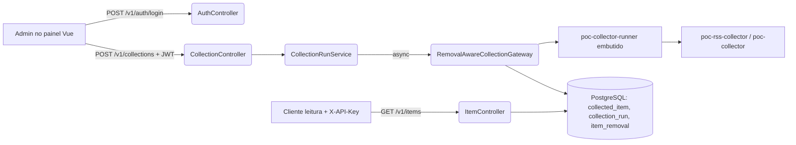

# Architecture overview

> Dashboard que coleta itens de várias fontes por meio do runner embutido, guarda no PostgreSQL e expõe consulta por API e painel Vue.

## Flow

## Key classes / entry points

| Class | Role |
|-------|------|
| `CollectionController` / `CollectionRunService` | Dispara e acompanha coletas assíncronas |
| `RemovalAwareCollectionGateway` | Chama o runner e ignora itens removidos |
| `ItemController` | Listagem filtrada/paginada e detalhe |
| `ItemRemovalService` | Remoção com motivo e auditoria |
| `SecurityConfiguration`, `AdminLoginService`, `JwtConfiguration` | Login admin, JWT e API key |
| `CollectionRunRecovery` | Marca execuções interrompidas no boot |

## Related

- [[integracao-runner-embutido]], [[dominio-coleta-e-itens]], [[dominio-autenticacao]], [[ops-deploy-railway]], `SPEC.md`
